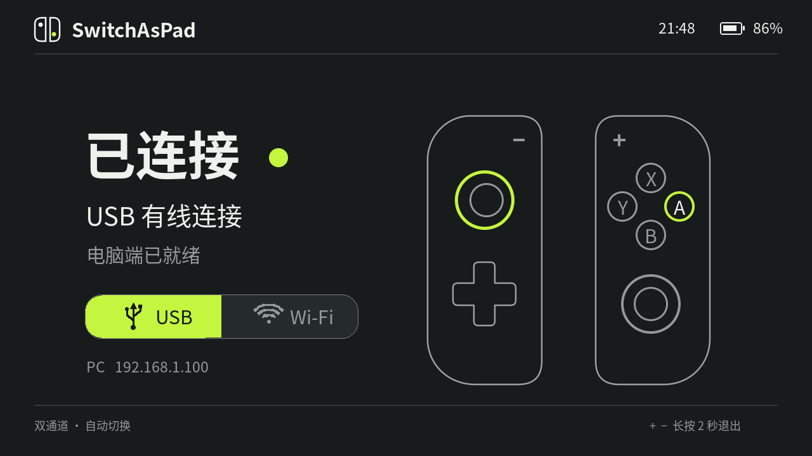

# SAP · SwitchAsPad

把 Nintendo Switch / Switch Lite 作为 Linux 电脑的手柄，通过 USB 或 Wi-Fi 控制模拟器和其他支持手柄的软件。



## 功能

- 传输 ABXY、方向键、双摇杆、摇杆按下、L/R/ZL/ZR、＋/－。
- USB 与 Wi-Fi 双通道，电脑端优先使用 USB。
- 断线 300 毫秒后释放虚拟手柄输入。
- Switch 界面显示时间、电量、供电状态、连接状态及实时输入；按固定 1280×720 画布等比显示。
- 按住＋和－两秒退出。界面不显示肩键，但肩键输入保留。

目前电脑接收端只支持 Linux，不支持 Windows、macOS、体感和震动。Switch 需要能运行 homebrew NRO 的环境；这不是免驱 USB HID 固件。

## Switch 安装

从源码编译 `switchaspad.nro`，复制到 SD 卡：

```text
/switch/switchaspad/switchaspad.nro
```

Wi-Fi 使用时，在同目录创建 `pc.txt`，只写电脑的局域网 IPv4 地址，例如 `192.168.1.100`。不提供该文件则使用局域网广播。电脑与 Switch 连接同一局域网，并允许 UDP 26780。USB 使用支持数据传输的线。

退出 DBI 等占用 USB 的应用，通过 hbmenu 启动 SwitchAsPad。

## Linux 接收端

以 Debian/Ubuntu 为例：

```bash
sudo apt install python3-venv libusb-1.0-0 acl
python3 -m venv .venv
.venv/bin/pip install -r pc/requirements.txt
sudo modprobe uinput
sudo setfacl -m "u:$(id -un):rw" /dev/uinput
```

USB 模式还需要设备访问权限。创建规则：

```bash
printf '%s\n' 'SUBSYSTEM=="usb", ATTR{idVendor}=="057e", ATTR{idProduct}=="3001", TAG+="uaccess"' | sudo tee /etc/udev/rules.d/70-switchaspad.rules
sudo udevadm control --reload-rules
```

随后重新插拔 USB，再启动接收端：

```bash
.venv/bin/python pc/receiver.py
# 或仅使用一种通道：
.venv/bin/python pc/receiver.py --transport wifi
.venv/bin/python pc/receiver.py --transport usb
```

`setfacl` 的授权在重启或设备重建后可能需要重做。接收端使用局域网 UDP，没有配对或认证，适合可信家庭网络，不应把端口转发到公网。

## 模拟器配置

输入设备选择 **SwitchAsPad**，模拟控制器类型选择 **Pro Controller**。按实际 Switch 按键确认 ABXY 映射；＋绑定 Start，－绑定 Back。设备未出现时刷新列表或重新打开模拟器。

## 编译 NRO

需要 Docker，官方 devkitPro 镜像包含本项目使用的 libnx 和 SDL2 库：

```bash
docker run --rm -v "$PWD:/src" -w /src devkitpro/devkita64:latest make -j4
```

输出为仓库根目录的 `switchaspad.nro`。`latest` 是可变标签，后续工具链更新可能影响构建。

## 本机界面预览

```bash
sudo apt install build-essential pkg-config libsdl2-dev libsdl2-ttf-dev libsdl2-gfx-dev
cc tools/preview.c source/ui.c -o preview $(pkg-config --cflags --libs sdl2 SDL2_ttf SDL2_gfx) -lm
SDL_VIDEODRIVER=dummy ./preview
```

生成 `preview.bmp`，使用演示时间、电量和输入；参数 `0` 为待连接，`1` 为 Wi-Fi，`2` 为 USB。

## 源码结构

- `source/main.c`：libnx 输入、系统状态、USB 与 UDP 传输。
- `source/ui.c`：动态界面、字体与等比显示。
- `romfs/layout.svg`：静态界面矢量源；`layout.bmp` 是嵌入 NRO 的栅格版本。
- `pc/receiver.py`：Linux uinput 虚拟手柄与双通道接收。

通信协议为 24 字节小端结构 `<4sIQhhhh`：`SPAD`、32 位序号、64 位 libnx 按钮位以及四个 16 位摇杆值。UDP 端口为 26780，确认消息为 `SPAK`。USB VID/PID 为 `057e:3001`，沿用当前原型配置，并非本项目获分配的 USB ID。

## 验证范围

USB 实机输入、电脑虚拟手柄及断线归零曾在开发机器验证。当前界面完成本机渲染与 NRO 编译；Switch Lite 的最新界面效果仍需实机确认。不能据此保证所有固件、主机或模拟器组合兼容。

## 许可

项目自有代码与界面资源采用 [MIT](LICENSE)。`romfs/ui.otf`、`romfs/bold.otf` 是 Adobe Source Han Sans SC 的字符子集，使用 [SIL Open Font License 1.1](romfs/OFL.txt)，不适用 MIT。构建依赖 libnx、SDL2、SDL2_ttf、SDL2_gfx 及其依赖，分别遵循各上游许可。
